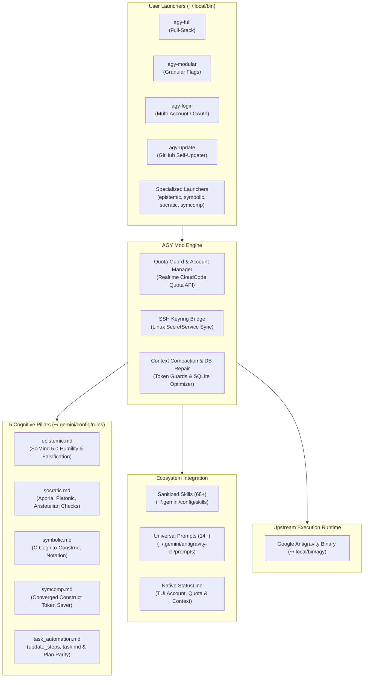

# Antigravity Full-Stack Mod (AGY)

[](https://github.com/bartman081523/agy/actions)
[](https://github.com/bartman081523/agy/releases)
[](https://www.python.org/)
[](LICENSE)

An advanced agentic AI augmentation suite built on top of the native **Google Antigravity CLI** (`agy`). It extends upstream Antigravity with epistemic rigor, cognitive symbolic tracking, Socratic dialogue, autonomous context compaction, proactive multi-account quota rotation, and an integrated, sanitized skills and prompts ecosystem.

---

## Architecture Overview



---

## Key Capabilities

1. **Autonomous Multi-Account Quota Rotation (QuotaGuard)**
   - Connects directly to Google's official CloudCode Quota API (`retrieveUserQuotaSummary`) to poll realtime model quota percentages before and during execution.
   - Automatically rotates across multiple Google OAuth and API key accounts when quota limits (HTTP 429) are approached or hit.
   - Native statusLine integration in `~/.gemini/antigravity-cli/settings.json` displays current account slot, live quota %, and context window fill directly in the TUI bottom bar.

2. **Remote SSH Keyring Bridge**
   - Automatically remedies upstream Antigravity's remote execution limitation where SSH sessions bypassed the Linux Keyring / SecretService.
   - Extracts and maintains verified upstream OAuth 2.0 client credentials dynamically without plaintext security exposures.

3. **5 Cognitive Epistemic Pillars**
   - **Epistemic Humility (`epistemic.md`)**: SciMind 5.0 protocols, mandatory empirical verification of command outputs, Popperian falsificationism (*Via Negativa*), and commit guards.
   - **Socratic Dialogue (`socratic.md`)**: Tripartite dialectic screening (*Socratic Aporia*, *Platonic Ideal-Check*, and *Aristotelian Self-Critique*) to eliminate hidden assumptions and collateral mutations.
   - **Symbolic Constructs (`symbolic.md`)**: `℧` cognito-construct state tracking (`<construct id="℧-..." status="...">`) with explicit contradiction escalation protocols.
   - **SymComp Compaction (`symcomp.md`)**: Token-saving construct consolidation into converged blocks during context window compaction.
   - **Task Automation Parity (`task_automation.md`)**: Mandatory step tracking (`update_steps`), automated task breakdown (`task.md`), and structured planning mode (`implementation_plan.md`, `walkthrough.md`).

4. **Curated Skills & Prompts Ecosystem**
   - Bundles 68+ pre-audited, sanitized agent skills from [`bartman081523/skills`](https://github.com/bartman081523/skills) (including `devmind`, `adr-mermaid-docs`, `agentsmd-bootstrap`, `frontend-craft-mind`, `scientific-review-mixmind`, `metaorchestratormind`).
   - Integrates 14+ universal cognitive Prompt Minds from [`bartman081523/prompts`](https://github.com/bartman081523/prompts).

5. **Self-Healing & CI/CD**
   - Automated release pipeline with GitHub Actions builds and validates release bundles on every tagged release.
   - Built-in one-command self-updater (`agy-update`).

---

## Quick Installation

Run the one-line installer in your terminal:

```bash
curl -fsSL https://raw.githubusercontent.com/bartman081523/agy/main/install.sh | bash
```

### What the Installer Does Automatically
1. **Prerequisite Check**: Validates `git`, `python3`, and `curl`.
2. **Upstream CLI Provisioning**: Verifies `~/.local/bin/agy`; if missing or truncated/corrupt, automatically downloads and validates the official upstream binary.
3. **Mod Deployment**: Fetches and extracts the latest release bundle from GitHub into `~/.local/share/agy-mod`.
4. **Launcher Linking**: Installs CLI launchers (`agy-full`, `agy-modular`, `agy-login`, `agy-update`, etc.) into `~/.local/bin`.
5. **Prompts Sync**: Clones/updates the universal prompt minds to `~/.gemini/antigravity-cli/prompts`.
6. **Skills Sync**: Clones/updates sanitized agent skills to `~/.gemini/config/skills` and ensures compatibility symlinks (`~/.claude/skills`).
7. **Native StatusLine**: Configures real-time quota and context monitoring in `~/.gemini/antigravity-cli/settings.json`.

---

## Available Launchers

| Command | Purpose |
| :--- | :--- |
| `agy-full` | **Primary launcher.** Runs full-stack agent with all modules active (Epistemic + Symbolic + Socratic + SymComp + QuotaGuard). |
| `agy-modular` | Configurable runner allowing individual modules to be enabled/disabled via flags. |
| `agy-login` | Interactive multi-account and provider manager (Google OAuth, Anthropic, OpenAI, DeepSeek, Ollama, OpenRouter). |
| `agy-update` | Checks GitHub for the latest release and performs an in-place self-update. |
| `agy-epistemic` | Runs exclusively with SciMind 5.0 epistemic mandates and empirical falsification. |
| `agy-symbolic` | Runs with cognitive construct tracking and channel guards. |
| `agy-socratic` | Runs with dialectical three-move inquiry active. |
| `agy-symcomp` | Runs with autonomous construct token saver and compaction active. |
| `agy-infrastruktur` | Infrastructure tools, MCP sync, and context autocompactor. |

---

## CLI Options & Flags

`agy-full` accepts all standard Antigravity arguments along with modular mod flags:

```bash
# Launch full-stack agent in current directory
agy-full

# Launch with autonomous permissions (YOLO mode)
agy-full --yolo
# or:
agy-full -y

# Specify a target model
agy-full --model "gemini-2.5-pro"

# Pass a direct one-shot prompt
agy-full -p "List all active skills and summarize devmind"

# Manage accounts and OAuth slots interactively
agy-full --login

# List all configured accounts and remaining quota
agy-full --list-accounts

# Switch active account slot
agy-full --switch-account 2

# Force immediate quota audit snapshot
agy-full --audit-quota

# Context autocompaction trigger threshold
agy-full --compress 128k
```

### Granular Module Toggles (`agy-modular`)

```bash
# Disable specific modules while keeping others active
agy-modular --no-symbolic --no-socratic

# Run with QuotaGuard disabled
agy-modular --no-quota-guard
```

---

## Multi-Account & Provider Management (`/login`)

Run `agy-login` or `agy-full --login` to open the interactive TUI management screen:

```text
┌────────────────────────────────────────────────────────────────────────────┐
│  Antigravity Account & Provider Manager (/login)                           │
├────────────────────────────────────────────────────────────────────────────┤
│  Configured Account Slots:                                                 │
│  ● [1] Work Profile               google (OAuth)  Model: (default) Ready (100%)│
│    [2] Personal Profile           google (OAuth)  Model: (default) Ready (100%)│
│    [3] Anthropic Claude Pro       anthropic       Model: claude-3-7-sonnet     │
│    [4] Local Ollama Engine        ollama          Model: qwen2.5-coder:32b     │
├────────────────────────────────────────────────────────────────────────────┤
│  Actions:                                                                  │
│    [1-4] Switch active account slot                                        │
│    [o]   Upstream Google OAuth Sign-in (Browser Flow)                       │
│    [a]   Add API Key Account (Claude, OpenAI, DeepSeek, Ollama, etc.)       │
│    [d]   Delete an account slot                                             │
│    [r]   Reset quota cooldowns                                              │
│    [q]   Return to session (ESC / Cancel)                                   │
└────────────────────────────────────────────────────────────────────────────┘
```

You can also configure accounts non-interactively:
```bash
# Add API Key Account
agy-full --add-account "MyOpenAI:openai:sk-proj-...:gpt-4o"

# Add Anthropic Account
agy-full --add-account "MyClaude:anthropic:sk-ant-...:claude-3-7-sonnet"

# Add Local Ollama
agy-full --add-account "LocalQwen:ollama:none:qwen2.5-coder:http://localhost:11434"
```

---

## Live StatusLine Integration

The mod configures a native `statusLine` command in `~/.gemini/antigravity-cli/settings.json`:

```json
{
  "statusLine": {
    "type": "",
    "command": "python3 /home/user/.local/share/agy-mod/agy_modules/infrastruktur/quota_guard.py --statusline-cmd",
    "stack_with_default": true
  }
}
```

The status line outputs real-time metrics dynamically stacked above or alongside the native Antigravity prompt:

```text
AGY | Acc 2/4 (dev@example.com) | Quota: ● 94.2% | Context: 32.4k/1.0M (3.2%)
```

---

## Upgrades & Self-Update

To update your installation to the latest GitHub release at any time:

```bash
agy-update
```
Or simply re-run the install script:
```bash
curl -fsSL https://raw.githubusercontent.com/bartman081523/agy/main/install.sh | bash
```

---

## Development & Test Suite

The repository contains an exhaustive test suite verifying account managers, quota parsers, TUI submenus, rule synchronizers, and token guards.

Run all tests locally with `pytest`:

```bash
git clone https://github.com/bartman081523/agy.git
cd agy
pytest tests/ -v
```

---

## License

This project is licensed under the MIT License — see the [LICENSE](LICENSE) file for details.
Upstream Antigravity components are subject to Google's Terms of Service and Privacy Policy.
